# 🔀 Diagramas MoLIC: ItaAluga

A MoLIC (*Modeling Language for Interaction as Conversation*) representa a interação entre o usuário e o sistema como uma conversa: cada cena é um momento do diálogo e cada transição é uma fala do usuário (**u:**) ou do designer (**d:**). Os diagramas desta página derivam dos [HTAs](./4-htas.md) e do [mapa de objetivos](./3-mapa-de-objetivos.md).

## Visão Geral do Diagrama Completo
 
A modelagem do ItaAluga é composta por **14 diagramas** que se conectam por cenas de referência. O usuário começa pelo cadastro ou pelo acesso, e o acesso leva à busca de equipamentos. Daí a conversa se ramifica entre alugar e anunciar, passa pela entrega e pela devolução do equipamento e, quando algo dá errado, segue para a resolução de problemas, mediada pelo suporte. Avaliações, reputação e pedidos de ajuda complementam o fluxo.

 
Clique na imagem para abri-la em tamanho original.

## Partes do Diagrama
 
Os diagramas foram agrupados em seis partes, que acompanham os pares de HTAs.
 
| # | Parte | Diagramas | HTAs relacionados |
| :---: | :--- | :--- | :--- |
| 1 | [Conta e Acesso](#1-conta-e-acesso) | Criar minha conta; Entrar no sistema e ajustar acessibilidade; Recuperar minha senha | [HTA 1](./4-htas.md#hta-1-criar-minha-conta), [HTA 2](./4-htas.md#hta-2-entrar-na-minha-conta) |
| 2 | [Anúncios e Gestão de Pedidos](#2-anúncios-e-gestão-de-pedidos) | Anunciar equipamento; Gerenciar anúncios e pedidos; Responder solicitação de aluguel | [HTA 3](./4-htas.md#hta-3-colocar-um-equipamento-para-alugar), [HTA 4](./4-htas.md#hta-4-gerenciar-meus-anúncios-e-pedidos) |
| 3 | [Busca e Aluguel](#3-busca-e-aluguel) | Buscar e alugar equipamento | [HTA 5](./4-htas.md#hta-5-encontrar-um-equipamento), [HTA 6](./4-htas.md#hta-6-alugar-um-equipamento) |
| 4 | [Entrega e Devolução](#4-entrega-e-devolução) | Entregar o equipamento; Devolver o equipamento | [HTA 7](./4-htas.md#hta-7-realizar-a-entrega-do-equipamento), [HTA 8](./4-htas.md#hta-8-concluir-a-devolução-do-equipamento) |
| 5 | [Problemas e Mediação](#5-problemas-e-mediação) | Resolver um problema no aluguel; Mediar um problema (Suporte) | [HTA 9](./4-htas.md#hta-9-resolver-um-problema-no-aluguel), [HTA 10](./4-htas.md#hta-10-analisar-e-resolver-disputas) |
| 6 | [Reputação e Ajuda](#6-reputação-e-ajuda) | Avaliar a outra pessoa e consultar reputação; Pedir ajuda e falar com o suporte; Atender pedido de ajuda (Suporte) | [HTA 11](./4-htas.md#hta-11-avaliar-e-ver-reputação), [HTA 12](./4-htas.md#hta-12-pedir-e-prestar-ajuda) |
 
---
 
## Detalhamento por Parte
 
### 1. Conta e Acesso
 
#### 1.1 Criar minha conta (Cadastro)

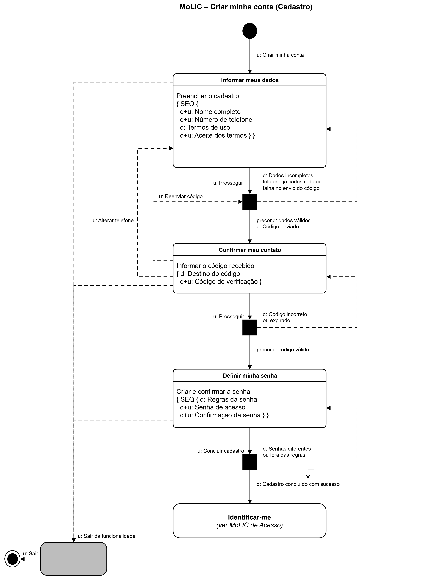
Este diagrama conduz o usuário do início do cadastro até a conta criada, em três cenas sequenciais. Cada avanço passa por uma validação do sistema, e os erros levam de volta à cena em que ocorreram. Ao final, o usuário é encaminhado ao diagrama de acesso para se identificar.
 
| Cena | O que representa | Transições principais |
| :--- | :--- | :--- |
| **Informar meus dados** | Preenchimento do cadastro, em sequência: nome completo, número de telefone, termos de uso e aceite dos termos. | **u: Criar minha conta** abre a cena. **u: Prosseguir** passa pela validação: se houver dados incompletos, telefone já cadastrado ou falha no envio do código, **d:** informa o erro e volta à cena; se os dados forem válidos, **d: Código enviado** leva à próxima cena. |
| **Confirmar meu contato** | O sistema informa o destino do código e o usuário digita o código de verificação recebido. | **u: Reenviar código** repete o envio. **u: Alterar telefone** volta a Informar meus dados. **u: Prosseguir** valida o código: se estiver incorreto ou expirado, **d:** informa e volta; se for válido, segue. |
| **Definir minha senha** | O sistema mostra as regras da senha e o usuário cria a senha e a confirma. | **u: Concluir cadastro** valida a senha: se as senhas forem diferentes ou fora das regras, **d:** informa e volta; se estiver correta, **d: Cadastro concluído com sucesso**. |
| **Identificar-me** | Cena de referência. | Remete ao diagrama de Acesso, para que o usuário entre com a conta recém-criada. |
 
#### 1.2 Entrar no sistema e ajustar acessibilidade (Acesso)

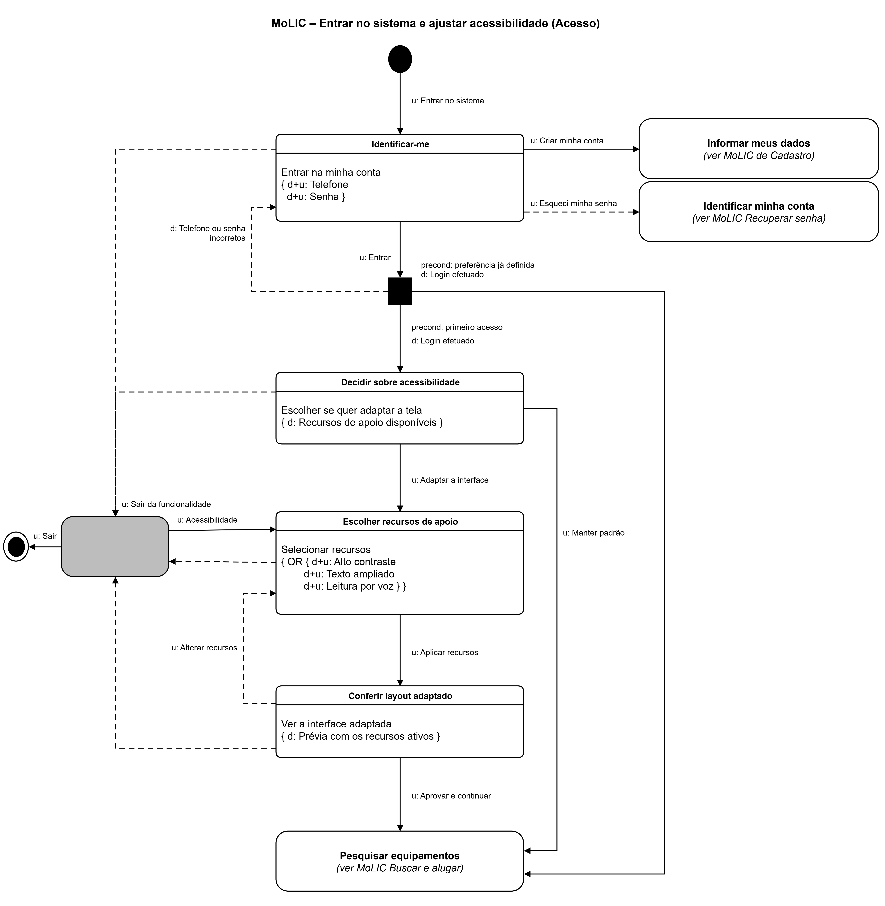
Este diagrama trata do login e dos recursos de acessibilidade. Depois do login, o caminho depende de o usuário já ter definido sua preferência de acessibilidade: se for o primeiro acesso, ele decide se quer adaptar a interface; se já tiver preferência, segue direto para a pesquisa de equipamentos. A acessibilidade também pode ser acionada a qualquer momento pelo acesso ubíquo.
 
| Cena | O que representa | Transições principais |
| :--- | :--- | :--- |
| **Identificar-me** | Entrada na conta com telefone e senha. | **u: Entrar no sistema** abre a cena. **u: Entrar** valida os dados: se telefone ou senha estiverem incorretos, **d:** informa e volta. Se o login for válido e for o **primeiro acesso**, segue para Decidir sobre acessibilidade; se a **preferência já estiver definida**, **d: Login efetuado** leva a Pesquisar equipamentos. **u: Criar minha conta** remete ao diagrama de Cadastro, e **u: Esqueci minha senha**, ao de Recuperar senha. |
| **Decidir sobre acessibilidade** | O sistema apresenta os recursos de apoio disponíveis e o usuário escolhe se quer adaptar a tela. | **u: Adaptar a interface** leva a Escolher recursos de apoio. **u: Manter padrão** segue para a pesquisa de equipamentos. |
| **Escolher recursos de apoio** | O usuário seleciona um ou mais recursos: alto contraste, texto ampliado e leitura por voz. | **u: Aplicar recursos** leva a Conferir layout adaptado. A cena também é alcançada por **u: Acessibilidade**, do acesso ubíquo. |
| **Conferir layout adaptado** | O sistema mostra uma prévia da interface com os recursos ativos. | **u: Aprovar e continuar** segue para a pesquisa de equipamentos. **u: Alterar recursos** volta a Escolher recursos de apoio. |
| **Pesquisar equipamentos** | Cena de referência. | Remete ao diagrama Buscar e alugar. |
 
#### 1.3 Recuperar minha senha

Este diagrama permite que quem esqueceu a senha volte a acessar a conta. O código enviado ao telefone comprova a identidade antes de a nova senha ser definida, e o fluxo termina no diagrama de acesso.
 
| Cena | O que representa | Transições principais |
| :--- | :--- | :--- |
| **Identificar minha conta** | O usuário informa o número de telefone e o canal de recebimento do código. | **u: Esqueci minha senha** abre a cena. **u: Enviar código**: se o telefone não for cadastrado ou o envio falhar, **d:** informa e volta; se der certo, **d: Código enviado**. |
| **Confirmar meu contato** | O sistema informa o destino do código e o usuário digita o código recebido. | **u: Reenviar código** repete o envio. **u: Alterar telefone** volta à cena anterior. **u: Prosseguir**: se o código estiver incorreto ou expirado, **d:** informa e volta; se for válido, segue. |
| **Definir nova senha** | O sistema mostra as regras e o usuário cria a nova senha e a confirma. | **u: Redefinir senha**: se as senhas forem diferentes ou fora das regras, **d:** informa e volta; se estiverem corretas, **d: Senha redefinida com sucesso**. |
| **Identificar-me** | Cena de referência. | Remete ao diagrama de Acesso, para entrar com a nova senha. |
 
---
 
### 2. Anúncios e Gestão de Pedidos
 
#### 2.1 Anunciar equipamento

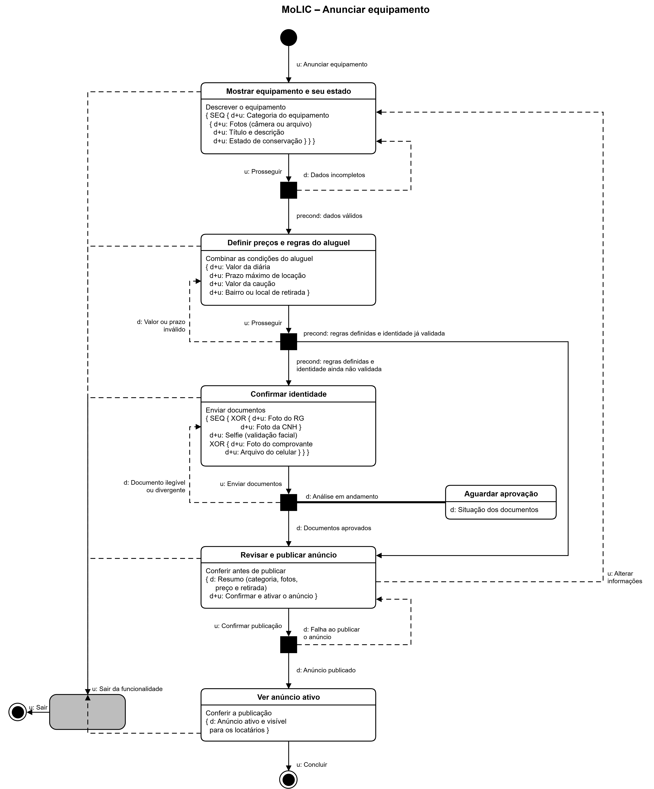
Este diagrama conduz o locador da descrição do equipamento até o anúncio ativo. Cada etapa tem uma validação, e a confirmação de identidade só é pedida se o usuário ainda não foi validado antes.
 
| Cena | O que representa | Transições principais |
| :--- | :--- | :--- |
| **Mostrar equipamento e seu estado** | O usuário descreve o equipamento: categoria, fotos (câmera ou arquivo), título e descrição e estado de conservação. | **u: Anunciar equipamento** abre a cena. **u: Prosseguir**: se os dados estiverem incompletos, **d:** informa e volta; se forem válidos, segue. |
| **Definir preços e regras do aluguel** | O usuário combina as condições: valor da diária, prazo máximo de locação, valor da caução e bairro ou local de retirada. | **u: Prosseguir**: se o valor ou o prazo forem inválidos, **d:** informa e volta. Com as regras definidas, se a **identidade ainda não foi validada**, segue para Confirmar identidade; se **já foi validada**, vai direto para Revisar e publicar. |
| **Confirmar identidade** | Envio de documentos em sequência: foto do RG ou da CNH, selfie para validação facial e comprovante (foto ou arquivo do celular). | **u: Enviar documentos**: se o documento estiver ilegível ou divergente, **d:** informa e volta; se for aceito, **d: Análise em andamento** leva a Aguardar aprovação. |
| **Aguardar aprovação** | O sistema mostra a situação dos documentos enquanto a análise acontece. | **d: Documentos aprovados** leva a Revisar e publicar anúncio. |
| **Revisar e publicar anúncio** | O sistema mostra o resumo (categoria, fotos, preço e retirada) e o usuário confirma a ativação. | **u: Alterar informações** volta às cenas de preenchimento. **u: Confirmar publicação**: se falhar, **d:** informa e volta; se der certo, **d: Anúncio publicado**. |
| **Ver anúncio ativo** | O sistema mostra o anúncio ativo e visível para os locatários. | **u: Concluir** encerra o fluxo. |
 
#### 2.2 Gerenciar anúncios e pedidos

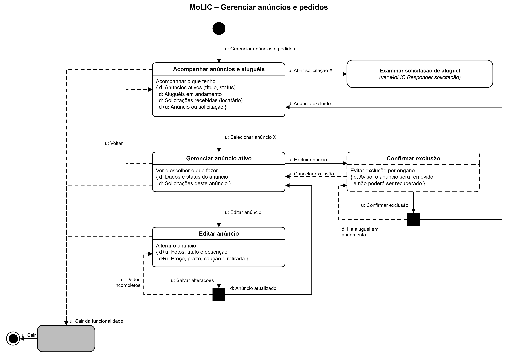
Este diagrama é o painel do locador. A partir de uma visão geral, ele abre uma solicitação recebida (que leva ao diagrama de resposta) ou seleciona um anúncio para editar ou excluir. A exclusão exige confirmação para evitar enganos.
 
| Cena | O que representa | Transições principais |
| :--- | :--- | :--- |
| **Acompanhar anúncios e aluguéis** | Visão geral: anúncios ativos (título e status), aluguéis em andamento e solicitações recebidas. | **u: Gerenciar anúncios e pedidos** abre a cena. **u: Abrir solicitação X** remete ao diagrama Responder solicitação. **u: Selecionar anúncio X** leva a Gerenciar anúncio ativo. |
| **Gerenciar anúncio ativo** | O sistema mostra os dados, o status e as solicitações do anúncio, e o usuário escolhe o que fazer. | **u: Editar anúncio** leva à edição. **u: Excluir anúncio** leva à confirmação. **u: Voltar** retorna à visão geral. |
| **Editar anúncio** | O usuário altera fotos, título e descrição, preço, prazo, caução e retirada. | **u: Salvar alterações**: se os dados estiverem incompletos, **d:** informa e volta; se estiverem corretos, **d: Anúncio atualizado**. |
| **Confirmar exclusão** | Aviso de que o anúncio será removido e não poderá ser recuperado. | **u: Cancelar exclusão** volta a Gerenciar anúncio ativo. **u: Confirmar exclusão**: se houver aluguel em andamento, **d:** informa e impede; caso contrário, **d: Anúncio excluído**. |
 
#### 2.3 Responder solicitação de aluguel

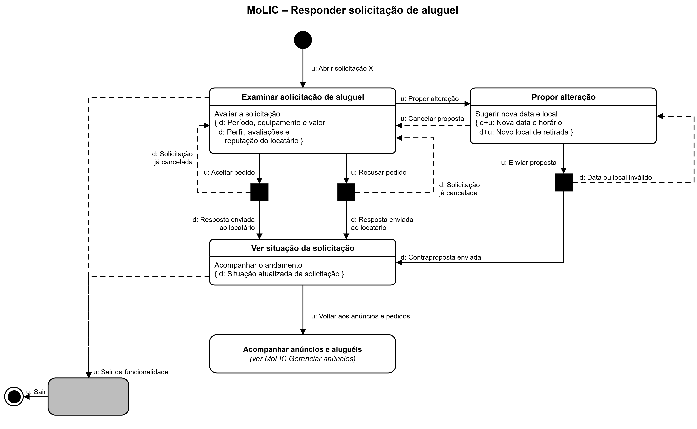
Este diagrama mostra como o locador decide sobre um pedido de aluguel: aceitar, recusar ou propor uma alteração. Em qualquer caso, a resposta é enviada ao locatário e o locador acompanha a situação da solicitação.
 
| Cena | O que representa | Transições principais |
| :--- | :--- | :--- |
| **Examinar solicitação de aluguel** | O sistema mostra o período, o equipamento, o valor e o perfil, as avaliações e a reputação do locatário. | **u: Abrir solicitação X** abre a cena. **u: Aceitar pedido** e **u: Recusar pedido** enviam a resposta: se a solicitação já tiver sido cancelada, **d:** informa; caso contrário, **d: Resposta enviada ao locatário** leva a Ver situação da solicitação. **u: Propor alteração** leva à cena de proposta. |
| **Propor alteração** | O usuário sugere nova data e horário e novo local de retirada. | **u: Enviar proposta**: se data ou local forem inválidos, **d:** informa e volta; se estiverem corretos, **d: Contraproposta enviada**. **u: Cancelar proposta** volta a Examinar solicitação. |
| **Ver situação da solicitação** | O sistema mostra a situação atualizada da solicitação. | **u: Voltar aos anúncios e pedidos** remete ao diagrama Gerenciar anúncios. |
 
---
 
### 3. Busca e Aluguel
 
#### 3.1 Buscar e alugar equipamento

Este é o diagrama mais longo e cobre toda a jornada do locatário, da busca até o comprovante do aluguel. Ele ramifica conforme a resposta do locador (aceito, contraproposta ou recusado) e pula a confirmação de identidade quando o usuário já foi validado.
 
| Cena | O que representa | Transições principais |
| :--- | :--- | :--- |
| **Pesquisar equipamentos** | Busca por nome ou categoria (escolha de uma) e, opcionalmente, por faixa de preço e bairro. | **u: Procurar equipamento** abre a cena. **u: Buscar**: se nada for encontrado, **d:** pede para refazer a busca; se houver resultados, segue. |
| **Examinar resultados da busca** | O sistema lista os anúncios (foto, diária e bairro) e o usuário escolhe um. | **u: Refinar busca** volta à pesquisa. **u: Selecionar anúncio** leva a Examinar anúncio. |
| **Examinar anúncio** | O sistema mostra fotos e estado de conservação, descrição e regras de uso, diária, caução, bairro de retirada e a reputação do locador. | **u: Voltar aos resultados** retorna à lista. **u: Alugar este equipamento** leva a Pedir aluguel. |
| **Pedir aluguel** | O usuário define data e horário de retirada e de devolução, e o sistema mostra o resumo dos valores. | **u: Solicitar aluguel**: se as datas estiverem indisponíveis, **d:** informa e volta. Com datas disponíveis, se a **identidade ainda não foi validada**, segue para Confirmar minha identidade; se **já foi validada**, vai direto para Acompanhar resposta do locador. |
| **Confirmar minha identidade** | Envio de documentos em sequência: RG ou CNH, selfie para validação facial e comprovante (foto ou arquivo). | **u: Enviar documentos**: se o documento estiver ilegível ou a selfie não conferir, **d:** informa e volta; se a identidade for validada, segue. |
| **Acompanhar resposta do locador** | O sistema mostra a situação e o prazo da resposta e uma das três respostas: pedido aceito, contraproposta ou pedido recusado. | **u: Responder contraproposta** leva a uma nova resposta do locador (**d:**). Se o pedido for **recusado**, **u: Escolher outro equipamento** volta à busca. Se for **aceito**, **u: Ir para o pagamento** segue. |
| **Realizar pagamento** | O sistema mostra a diária e a caução e o usuário paga por Pix (código ou QR code) ou cartão, e confirma. | **u: Confirmar pagamento**: se for recusado ou o cartão for inválido, **d:** informa e volta; se der certo, **d: Pagamento confirmado**. |
| **Ver comprovante do aluguel** | O sistema mostra o comprovante e o código de retirada, o endereço e o telefone do locador, e as datas e horários combinados. | **u: Concluir** encerra o fluxo. |
 
---
 
### 4. Entrega e Devolução
 
#### 4.1 Entregar o equipamento

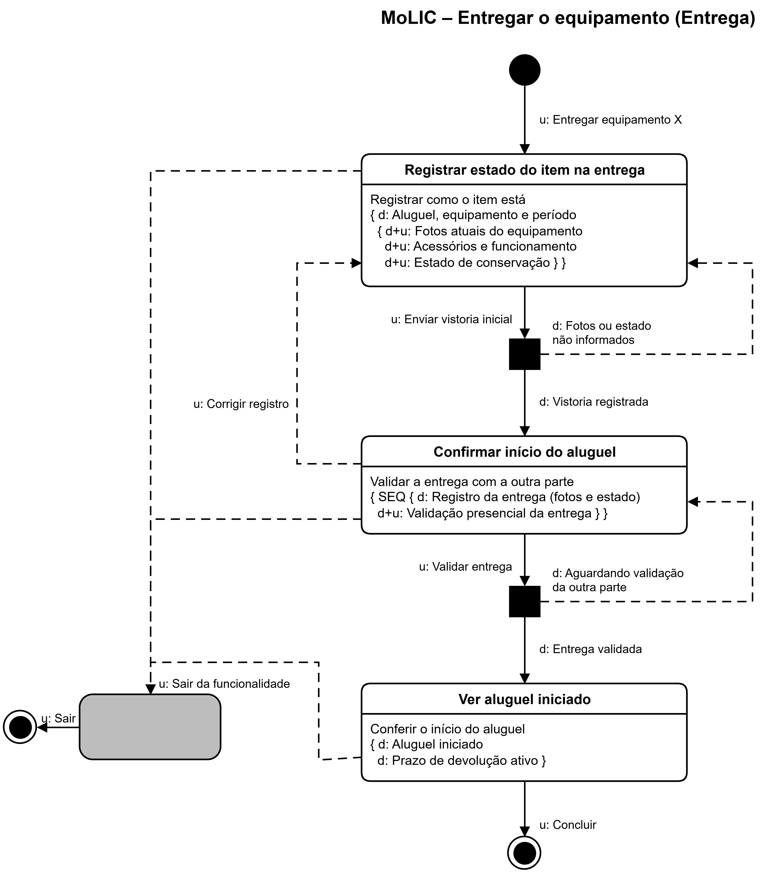
Este diagrama registra o início do aluguel. A vistoria inicial cria uma prova do estado do equipamento, e a entrega só é considerada válida depois que a outra parte também a valida presencialmente.
 
| Cena | O que representa | Transições principais |
| :--- | :--- | :--- |
| **Registrar estado do item na entrega** | O sistema mostra o aluguel, o equipamento e o período, e o usuário registra fotos atuais, acessórios e funcionamento e o estado de conservação. | **u: Entregar equipamento X** abre a cena. **u: Enviar vistoria inicial**: se faltarem fotos ou estado, **d:** informa; se estiver completa, **d: Vistoria registrada** segue. |
| **Confirmar início do aluguel** | O sistema mostra o registro da entrega (fotos e estado) e o usuário faz a validação presencial com a outra parte. | **u: Corrigir registro** volta à cena anterior. **u: Validar entrega**: enquanto a outra parte não validar, **d: Aguardando validação da outra parte**; quando validar, **d: Entrega validada**. |
| **Ver aluguel iniciado** | O sistema mostra o aluguel iniciado e o prazo de devolução ativo. | **u: Concluir** encerra o fluxo. |
 
#### 4.2 Devolver o equipamento

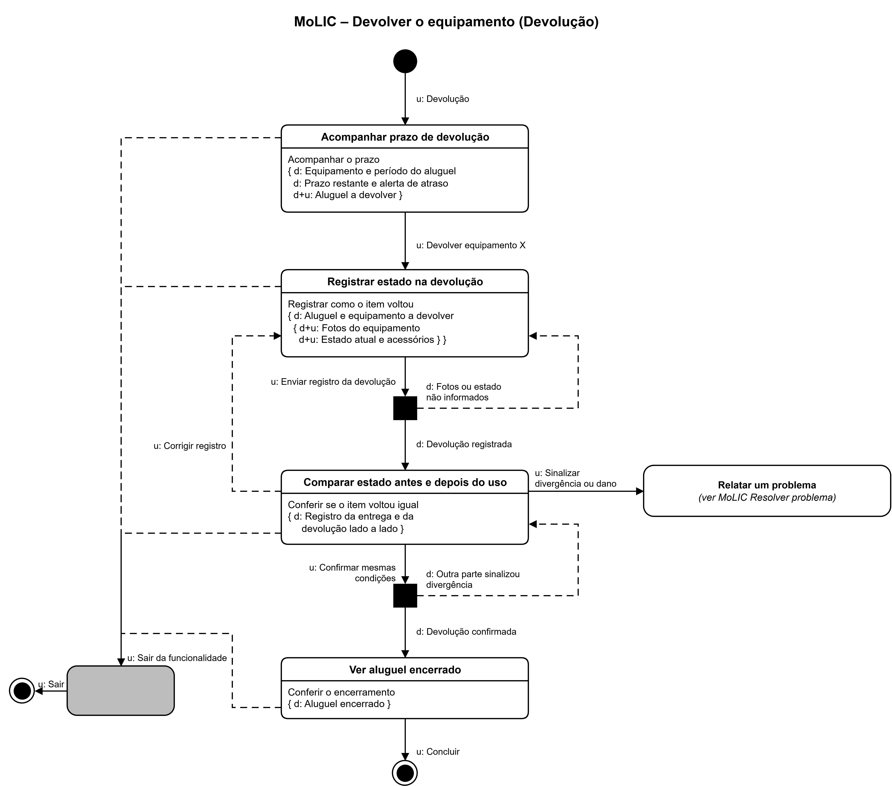
Este diagrama encerra o aluguel. O registro da devolução é comparado com o da entrega: se o equipamento voltou igual, o aluguel é encerrado; se houve divergência ou dano, a conversa segue para o diagrama de resolução de problemas.
 
| Cena | O que representa | Transições principais |
| :--- | :--- | :--- |
| **Acompanhar prazo de devolução** | O sistema mostra o equipamento, o período, o prazo restante e o alerta de atraso, e o usuário escolhe o aluguel a devolver. | **u: Devolução** abre a cena. **u: Devolver equipamento X** leva ao registro. |
| **Registrar estado na devolução** | O usuário registra fotos do equipamento, o estado atual e os acessórios. | **u: Enviar registro da devolução**: se faltarem fotos ou estado, **d:** informa; se estiver completo, **d: Devolução registrada**. **u: Corrigir registro** volta à cena. |
| **Comparar estado antes e depois do uso** | O sistema mostra o registro da entrega e o da devolução lado a lado. | **u: Confirmar mesmas condições**: se a outra parte tiver sinalizado divergência, **d:** informa; caso contrário, **d: Devolução confirmada**. **u: Sinalizar divergência ou dano** leva a Relatar um problema. |
| **Relatar um problema** | Cena de referência. | Remete ao diagrama Resolver problema. |
| **Ver aluguel encerrado** | O sistema confirma que o aluguel foi encerrado. | **u: Concluir** encerra o fluxo. |
 
---
 
### 5. Problemas e Mediação
 
#### 5.1 Resolver um problema no aluguel

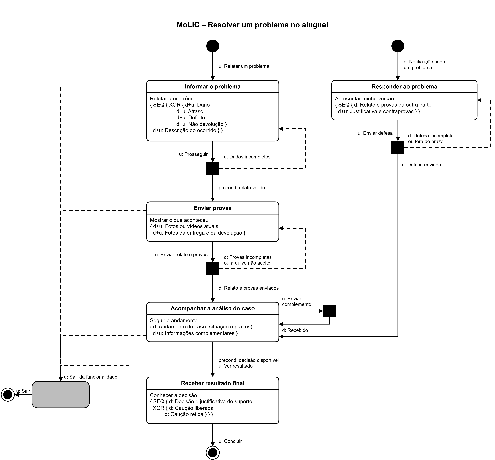
Este diagrama cobre os dois lados de um problema. Quem identifica a ocorrência a relata e envia provas, e a outra parte é notificada e responde com sua versão. Os dois acompanham a análise e recebem o resultado final.
 
| Cena | O que representa | Transições principais |
| :--- | :--- | :--- |
| **Informar o problema** | O usuário escolhe o motivo (dano, atraso, defeito ou não devolução) e descreve o ocorrido. | **u: Relatar um problema** abre a cena. **u: Prosseguir**: se os dados estiverem incompletos, **d:** informa e volta; se o relato for válido, segue. |
| **Enviar provas** | O usuário anexa fotos ou vídeos atuais e as fotos da entrega e da devolução. | **u: Enviar relato e provas**: se as provas estiverem incompletas ou o arquivo não for aceito, **d:** informa e volta; se der certo, **d: Relato e provas enviados**. |
| **Responder ao problema** | O sistema mostra o relato e as provas da outra parte, e o usuário escreve a justificativa e anexa contraprovas. | **d: Notificação sobre um problema** abre a cena para a outra parte. **u: Enviar defesa**: se estiver incompleta ou fora do prazo, **d:** informa e volta; se der certo, **d: Defesa enviada**. |
| **Acompanhar a análise do caso** | O sistema mostra o andamento (situação e prazos) e o usuário pode enviar informações complementares. | **u: Enviar complemento** leva a **d: Recebido**. Quando a decisão estiver disponível, **u: Ver resultado** segue. |
| **Receber resultado final** | O sistema mostra a decisão e a justificativa do suporte e o destino da caução (liberada ou retida). | **u: Concluir** encerra o fluxo. |
 
#### 5.2 Mediar um problema (Suporte)

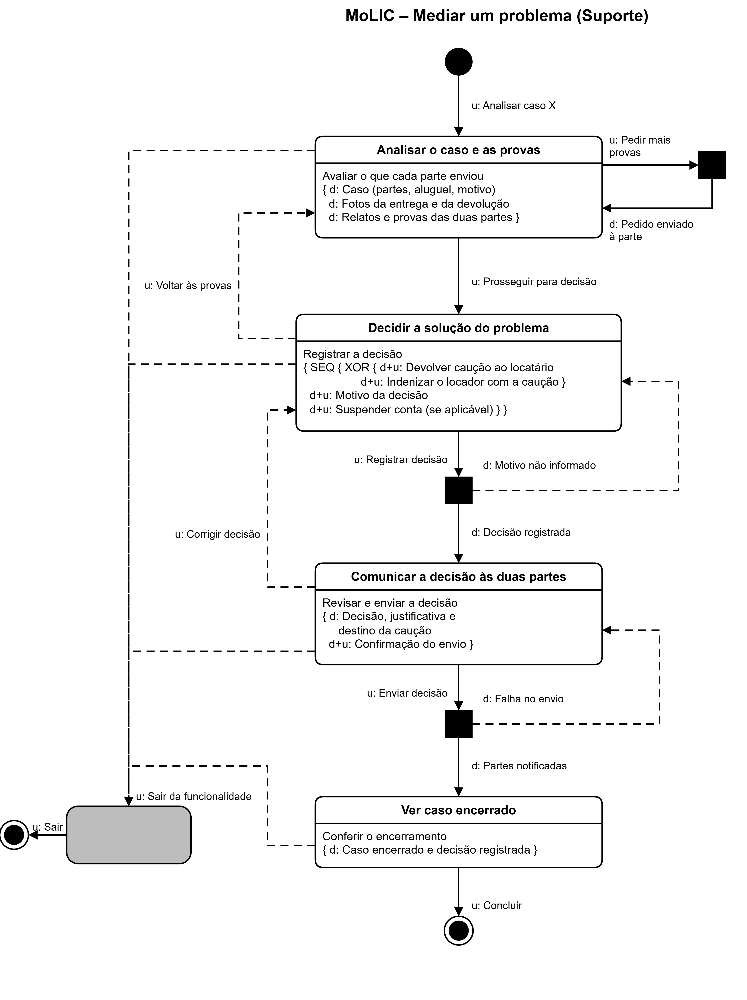
Este é o lado do Suporte Técnico no mesmo caso. O suporte analisa as provas das duas partes, decide a solução, registra o motivo e comunica a decisão a ambos.
 
| Cena | O que representa | Transições principais |
| :--- | :--- | :--- |
| **Analisar o caso e as provas** | O sistema mostra o caso (partes, aluguel e motivo), as fotos da entrega e da devolução e os relatos e provas das duas partes. | **u: Analisar caso X** abre a cena. **u: Pedir mais provas** envia o pedido a uma das partes (**d: Pedido enviado à parte**). **u: Prosseguir para decisão** segue. |
| **Decidir a solução do problema** | O suporte escolhe entre devolver a caução ao locatário ou indenizar o locador com a caução, registra o motivo e, se aplicável, suspende a conta. | **u: Voltar às provas** retorna à análise. **u: Registrar decisão**: se o motivo não for informado, **d:** informa; **u: Corrigir decisão** volta à cena; se estiver completa, **d: Decisão registrada** segue. |
| **Comunicar a decisão às duas partes** | O sistema mostra a decisão, a justificativa e o destino da caução, e o suporte confirma o envio. | **u: Enviar decisão**: se houver falha no envio, **d:** informa; se der certo, **d: Partes notificadas**. |
| **Ver caso encerrado** | O sistema confirma que o caso foi encerrado e a decisão registrada. | **u: Concluir** encerra o fluxo. |
 
---
 
### 6. Reputação e Ajuda
 
#### 6.1 Avaliar a outra pessoa e consultar reputação

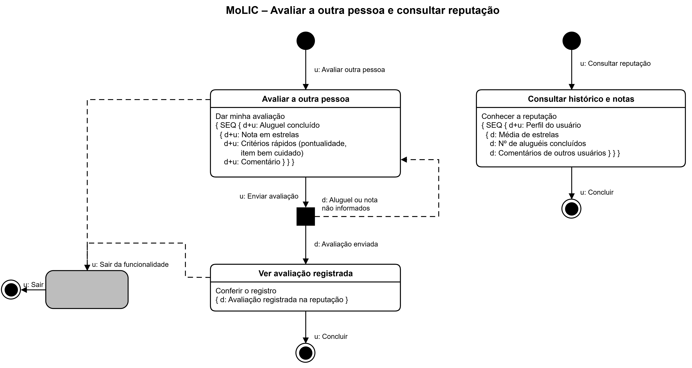
Este diagrama tem duas entradas independentes: avaliar quem participou de um aluguel concluído e consultar a reputação de qualquer usuário.
 
| Cena | O que representa | Transições principais |
| :--- | :--- | :--- |
| **Avaliar a outra pessoa** | O usuário escolhe o aluguel concluído e dá nota em estrelas, critérios rápidos (pontualidade e item bem cuidado) e comentário. | **u: Avaliar outra pessoa** abre a cena. **u: Enviar avaliação**: se o aluguel ou a nota não forem informados, **d:** informa e volta; se der certo, **d: Avaliação enviada**. |
| **Ver avaliação registrada** | O sistema mostra que a avaliação foi registrada na reputação. | **u: Concluir** encerra o fluxo. |
| **Consultar histórico e notas** | O usuário abre o perfil de alguém e o sistema mostra a média de estrelas, o número de aluguéis concluídos e os comentários de outros usuários. | **u: Consultar reputação** abre a cena. **u: Concluir** encerra o fluxo. |
 
#### 6.2 Pedir ajuda e falar com o suporte

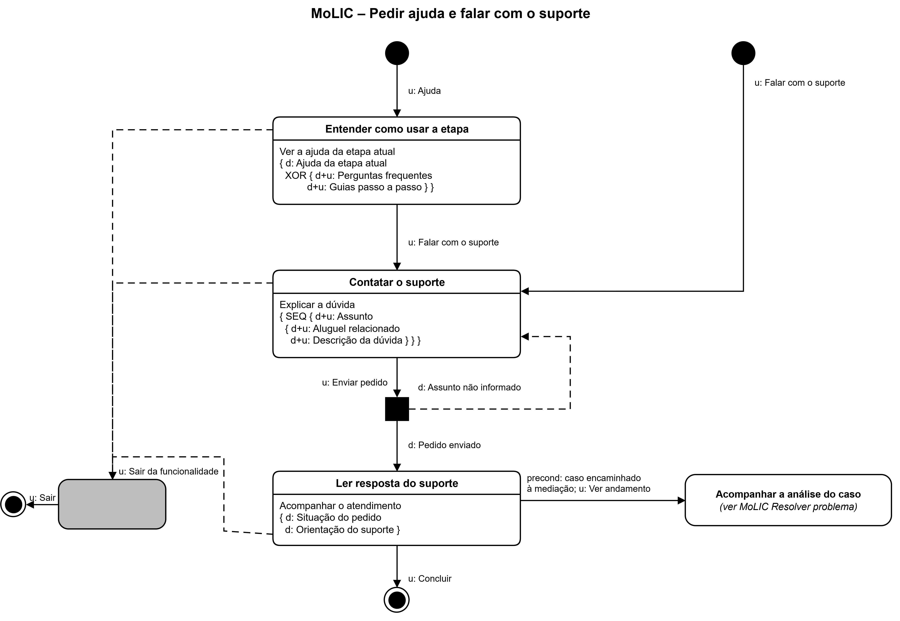
Este diagrama oferece dois níveis de ajuda: primeiro, a ajuda da própria etapa; depois, o contato com o suporte. Se o suporte encaminhar o caso à mediação, o usuário acompanha o andamento no diagrama de resolução de problemas.
 
| Cena | O que representa | Transições principais |
| :--- | :--- | :--- |
| **Entender como usar a etapa** | O sistema mostra a ajuda da etapa atual, com perguntas frequentes ou guias passo a passo (escolha de um). | **u: Ajuda** abre a cena. **u: Falar com o suporte** leva ao contato. |
| **Contatar o suporte** | O usuário informa o assunto, o aluguel relacionado e a descrição da dúvida. | **u: Falar com o suporte**, também disponível sem passar pela ajuda, abre a cena. **u: Enviar pedido**: se o assunto não for informado, **d:** informa e volta; se der certo, **d: Pedido enviado**. |
| **Ler resposta do suporte** | O sistema mostra a situação do pedido e a orientação do suporte. | Se o caso for encaminhado à mediação (**precond**), **u: Ver andamento** leva a Acompanhar a análise do caso. **u: Concluir** encerra o fluxo. |
| **Acompanhar a análise do caso** | Cena de referência. | Remete ao diagrama Resolver problema. |
 
#### 6.3 Atender pedido de ajuda (Suporte)

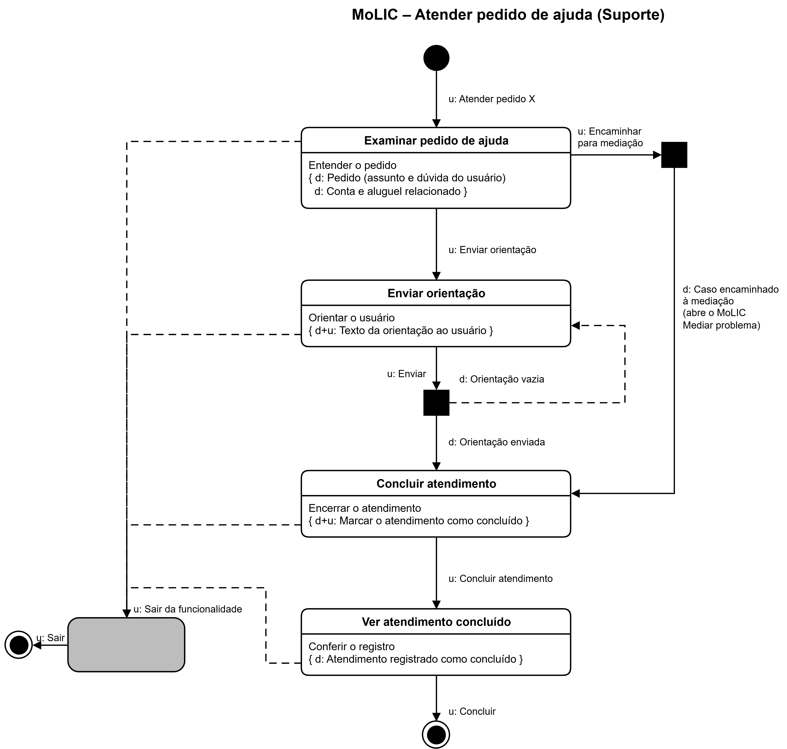
Este é o lado do Suporte Técnico no atendimento. O suporte examina o pedido e orienta o usuário diretamente ou, quando o assunto é uma disputa, encaminha o caso à mediação.
 
| Cena | O que representa | Transições principais |
| :--- | :--- | :--- |
| **Examinar pedido de ajuda** | O sistema mostra o pedido (assunto e dúvida do usuário) e a conta e o aluguel relacionados. | **u: Atender pedido X** abre a cena. **u: Enviar orientação** segue para a orientação. **u: Encaminhar para mediação** gera **d: Caso encaminhado à mediação**, que abre o diagrama Mediar problema. |
| **Enviar orientação** | O suporte escreve o texto da orientação ao usuário. | **u: Enviar**: se a orientação estiver vazia, **d:** informa e volta; se der certo, **d: Orientação enviada**. |
| **Concluir atendimento** | O suporte marca o atendimento como concluído. | **u: Concluir atendimento** segue. |
| **Ver atendimento concluído** | O sistema mostra o atendimento registrado como concluído. | **u: Concluir** encerra o fluxo. |
 
---
 
## Consistência com os HTAs e os Sketches
 
Cada cena do MoLIC corresponde a tarefas definidas nos HTAs e é a base das telas desenhadas nos [sketches](../03-prototipacao/1-sketches.md).
 
| Parte do MoLIC | HTAs | Telas nos sketches |
| :--- | :---: | :--- |
| Conta e Acesso | 1, 2 | [Tela(s) correspondente(s)] |
| Anúncios e Gestão de Pedidos | 3, 4 | [Tela(s) correspondente(s)] |
| Busca e Aluguel | 5, 6 | [Tela(s) correspondente(s)] |
| Entrega e Devolução | 7, 8 | [Tela(s) correspondente(s)] |
| Problemas e Mediação | 9, 10 | [Tela(s) correspondente(s)] |
| Reputação e Ajuda | 11, 12 | [Tela(s) correspondente(s)] |
 