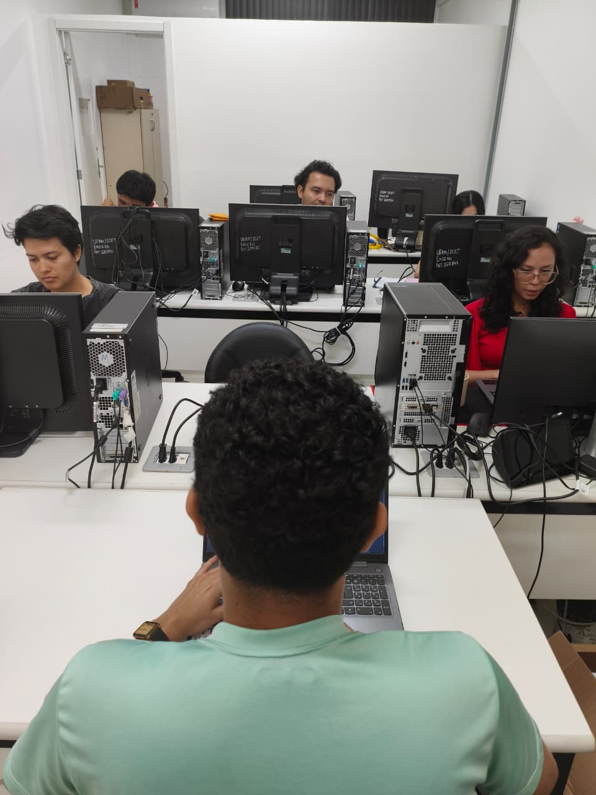

# Avaliação de Usabilidade — Inspeção Heurística

## 1. Introdução

Esta seção apresenta o processo de inspeção de usabilidade realizado no sistema Lucidchart, utilizando o método de Avaliação Heurística baseado nas dez heurísticas de usabilidade propostas por Jakob Nielsen.

O objetivo da avaliação é identificar problemas de usabilidade na interface do sistema, considerando aspectos como a clareza das informações, a consistência dos elementos, a facilidade de aprendizagem, a eficiência da navegação e a compreensão das funcionalidades.

A avaliação foi organizada em quatro etapas: detecção de defeitos, coleção de defeitos, discriminação de defeitos e relato dos resultados. O processo busca reunir os problemas identificados individualmente pelos integrantes, analisar sua validade e apresentar sugestões de melhoria para a interface.

## 2. Objetivos e escopo da avaliação

O objetivo geral da avaliação é identificar problemas de usabilidade presentes no Lucidchart por meio da análise de sua interface com base nas heurísticas de Nielsen.

A inspeção abrange as telas e funcionalidades exploradas pelos integrantes durante a avaliação, incluindo a página inicial, a criação e edição de documentos, os ícones das ferramentas, a navegação entre as telas e a área de modelos.

A análise considera os problemas observados durante a interação com o sistema, sem abranger funcionalidades que não tenham sido efetivamente avaliadas pelos integrantes.

## 3. Método utilizado

A Avaliação Heurística é um método de inspeção de usabilidade no qual avaliadores examinam uma interface com base em princípios gerais de usabilidade, denominados heurísticas.

Neste trabalho, cada integrante realiza a inspeção individualmente, explorando as telas e funcionalidades do Lucidchart de forma independente, sem seguir um roteiro de tarefas previamente estabelecido.

Durante a exploração, cada avaliador registra os problemas identificados, informando sua localização na interface, uma descrição do problema e a heurística relacionada.

Após as inspeções individuais, os registros são reunidos e comparados. Os problemas identificados são analisados para verificar possíveis repetições e determinar se representam defeitos reais de usabilidade ou falsos positivos. Por fim, os defeitos confirmados são organizados em um relatório com seus respectivos graus de severidade e sugestões de melhoria.

## 4. Heurísticas de Nielsen

A inspeção utiliza as dez heurísticas apresentadas no material didático da disciplina de Interação Humano-Computador.

| Código | Heurística | Descrição |
|---|---|---|
| H1 | Visibilidade do status do sistema | Manter os usuários informados sobre o que está acontecendo no sistema. |
| H2 | Compatibilidade do sistema com o mundo real | Utilizar a linguagem do usuário e apresentar as informações de forma lógica e natural. |
| H3 | Controle e liberdade do usuário | Proporcionar saídas claras para que o usuário possa sair de situações indesejadas. |
| H4 | Consistência e padrões | Manter padrões consistentes para palavras, situações, elementos e ações semelhantes. |
| H5 | Prevenção de erros | Utilizar um design que previna a ocorrência de erros antes que eles aconteçam. |
| H6 | Reconhecer ao invés de relembrar | Tornar objetos, ações e opções visíveis, reduzindo a necessidade de memorizar informações. |
| H7 | Flexibilidade e eficiência de uso | Fornecer atalhos e recursos que tornem as ações frequentes mais eficientes. |
| H8 | Estética e design minimalista | Evitar informações irrelevantes ou raramente necessárias na interface. |
| H9 | Ajudar os usuários a reconhecer, diagnosticar e corrigir erros | Apresentar mensagens claras que expliquem o problema e indiquem como resolvê-lo. |
| H10 | Ajuda e documentação | Disponibilizar ajuda e documentação para auxiliar o usuário na utilização do sistema. |

## 5. Processo de inspeção

O processo de inspeção foi dividido em quatro etapas: detecção, coleção, discriminação e relato dos resultados.

### 5.1. Detecção de defeitos

Nesta etapa, cada integrante realiza a exploração individual do Lucidchart, percorrendo suas telas e funcionalidades de maneira independente.

Os problemas identificados são registrados em tabelas individuais, com um registro para cada problema encontrado. Cada registro deve conter um identificador, a localização do problema na interface, sua descrição e a heurística violada.

### 5.2. Tela de Detecção no Notion

*Figura 1 - Tela de organização da etapa de Detecção no Notion.*

# Registros individuais dos integrantes

## Integrante 1 — [Nádia](https://app.notion.com/p/3f1d4fd66fdb80a2b3cdc22590dc1b20?v=9ecd4fd66fdb82b1ab6808c0e448e722&source=copy_link)

| ID | Localização | Descrição do problema | Heurística violada |
|---|---|---|---|
| ND-01 | Página inicial — opções para criar novo documento | Na página inicial do Lucidchart, o sistema apresenta as opções Lucidchart, descrito como “diagrama inteligente”, e Lucidspark, descrito como “quadro branco virtual”. Entretanto, essas descrições não esclarecem suficientemente as diferenças de finalidade e uso entre as ferramentas, podendo gerar dúvidas na escolha, principalmente para usuários iniciantes. | H2. Compatibilidade do sistema com o mundo real |
| ND-02 | Página inicial — opção “Criar a partir de modelo” | No menu de criação de documentos, a opção “Criar a partir de modelo” é apresentada separadamente das opções Lucidchart e Lucidspark. Ao selecionar essa opção, o usuário é direcionado ao Lucidspark, sem que essa informação esteja explícita no menu anterior. | H2. Compatibilidade do sistema com o mundo real |
| ND-03 | Página inicial — opção “Importar arquivo”, dentro de “Criar novo documento” | Ao tentar importar uma imagem, o sistema apresentou a mensagem: “Seu navegador bloqueou a abertura de uma nova guia. Permita pop-ups para a Lucid e importe a imagem novamente.” Embora a mensagem informe a provável causa do problema e sugira uma solução, o usuário pode não saber o que são pop-ups, como permitir sua abertura no navegador ou onde encontrar essa configuração. | H9. Ajudar os usuários a reconhecer, diagnosticar e corrigir erros |
| ND-04 | Página de edição do Lucidspark — recurso de apresentação do mapa conceitual | Durante a criação de uma apresentação, ao selecionar uma região do mapa conceitual para inseri-la em um slide, foi difícil mover e posicionar o retângulo azul que delimita a área selecionada. | H3. Controle e liberdade do usuário; H7. Flexibilidade e eficiência de uso |
| ND-05 | Área de edição do Lucidchart | Durante a edição, foi possível girar algumas formas, enquanto outras não permitiram realizar essa ação. Essa diferença de comportamento pode dificultar a compreensão das possibilidades de edição de cada elemento. | H3. Controle e liberdade do usuário; H4. Consistência e padrões |
| ND-06 | Página “Meus documentos” do Lucid | Na visualização em cartões, o sistema apresenta o status dos documentos, como “Concluído” e “Rascunho”. Entretanto, ao mudar para a visualização em lista, essas informações deixam de aparecer, dificultando a consulta ao status dos documentos nesse formato. | H1. Visibilidade do status do sistema; H6. Reconhecer ao invés de relembrar |
| ND-07 | Painel lateral “Pesquisar formas e ferramentas”, na área de edição do Lucidchart | Na parte inferior do painel de formas, alguns elementos aparecem parcialmente visíveis. Ao utilizar a barra de rolagem vertical para visualizar o restante, ela chega ao limite sem permitir o acesso completo a essas formas. | H6. Reconhecer ao invés de relembrar |
| ND-08 | Ferramenta de comentários do Lucidchart | Ao selecionar o ícone de comentários, a interface apresenta um painel lateral com a opção “Adicionar novo comentário”. Entretanto, clicar no botão “+” não inicia diretamente a escrita do comentário; é necessário clicar em uma região da página para abrir o campo de texto. | H3. Controle e liberdade do usuário; H8. Estética e design minimalista |

## Integrante 2 — [Marcos](https://app.notion.com/p/3f1d4fd66fdb8030b9d8c96fcd92bc6e?v=322d4fd66fdb83c7b17b885390a22560&source=copy_link)

| ID | Localização | Descrição do problema | Heurística violada |
|---|---|---|---|
| MO-01 | Tela de entrada — CTAs “Cadastre-se gratuitamente” (cabeçalho e seção principal) e “Teste grátis” (final da página) | Os rótulos variam entre ações aparentemente equivalentes. Os botões direcionam à página de preços, em vez de iniciar diretamente um cadastro, o que pode contrariar a expectativa do usuário. Além disso, o botão “Teste grátis” direciona para um destino diferente. | H2. Compatibilidade do sistema com o mundo real; H4. Consistência e padrões |
| MO-02 | Tela de login — título “Teste grátis ou faça login” e botões “Continuar com…” | A tela mistura opções de cadastro e login sem distinguir claramente as duas ações. O usuário pode não saber se está entrando em uma conta existente ou criando uma nova, aumentando o risco de iniciar um cadastro por engano ao escolher um método diferente do utilizado anteriormente. | H1. Visibilidade do status do sistema; H5. Prevenção de erros |
| MO-03 | Tela de login — caixa de seleção “Lembrar”, marcada por padrão | O texto não esclarece o que será lembrado, como o e-mail ou a sessão, nem por quanto tempo. Além disso, a opção já vem marcada, o que pode representar um risco de privacidade em computadores compartilhados. | H1. Visibilidade do status do sistema; H3. Controle e liberdade do usuário; H5. Prevenção de erros |
| MO-04 | Tela de login — campo “E-mail profissional” | O termo “profissional” pode levar o usuário a acreditar que endereços pessoais, como Gmail ou Outlook, não são aceitos, sem que essa restrição seja esclarecida na interface. | H5. Prevenção de erros |
| MO-05 | Tela de login — botão “Continuar com SSO” | A sigla técnica “SSO” não é explicada, podendo dificultar a compreensão por usuários iniciantes. Além disso, o ícone de chave pode sugerir uma ação relacionada a senhas, em vez de esclarecer a função do login único. | H2. Compatibilidade do sistema com o mundo real |
| MO-06 | Tela inicial — botão “Atualizar”, ao lado de “Plano gratuito” | O rótulo “Atualizar” pode ser interpretado como recarregar a página ou atualizar a versão do sistema, mas a ação pretendida é fazer upgrade do plano. O termo também difere de “Faça upgrade”, utilizado em outra área, e o seletor “Plano gratuito” aparece separado do botão. | H4. Consistência e padrões |
| MO-07 | Tela inicial — opções “Lucidchart” e “Lucidspark” | A interface organiza as opções pelo nome dos produtos, e não pelas atividades que o usuário deseja realizar, como criar um diagrama ou um quadro branco. Usuários que não conhecem as marcas podem ter dificuldade para identificar qual ferramenta atende à sua necessidade. | H2. Compatibilidade do sistema com o mundo real |
| MO-08 | Tela inicial — opções “Crie com IA”, “Crie usando IA” e “Criar a partir de modelo” | Funções semelhantes aparecem em diferentes níveis da interface, mas a diferença entre elas não é explicitada. O usuário pode não compreender se as opções de criação com IA oferecem os mesmos recursos ou a quais produtos pertencem os modelos apresentados. | H4. Consistência e padrões; H6. Reconhecer ao invés de relembrar |
| MO-09 | Tela do editor — barra vertical de ferramentas à esquerda, cabeçalho direito e barra inferior | A maioria dos controles é representada apenas por ícones, sem rótulos visíveis, e alguns são ambíguos. Usuários iniciantes precisam passar o ponteiro sobre cada ícone para descobrir sua função, o que pode tornar a utilização das ferramentas mais lenta. | H6. Reconhecer ao invés de relembrar |
| MO-10 | Tela do editor — painel esquerdo e barra vertical de ferramentas | Alguns itens, como texto, retângulo, seta, nota e busca, aparecem tanto no painel esquerdo quanto na barra vertical. Também existem dois pontos de acesso à busca: o campo “Pesquisar formas e ferramentas” e a lupa da barra vertical. Essa duplicação pode gerar dúvidas sobre a função de cada opção. | H4. Consistência e padrões; H8. Estética e design minimalista |

## Integrante 3 — [Matheus](https://app.notion.com/p/3f1d4fd66fdb80dda92fe0e292e8548a?v=d1bd4fd66fdb820a8aef08225c422c8e&source=copy_link)

| ID | Localização | Descrição do problema | Heurística violada |
|---|---|---|---|
| MDG-01 | Tela 1 — Cabeçalho, barra dupla de navegação (Lucid + Lucidchart) | Duas barras de navegação empilhadas, com menus diferentes, podem gerar confusão. A divisão entre a marca Lucid e o produto Lucidchart prejudica a clareza sobre onde o usuário está navegando. | H8. Estética e design minimalista |
| MDG-02 | Tela 2 — Cartões de planos, preço do plano Gratuito | A falta de padronização nas informações dos planos, com ausência de legenda de cobrança no plano Gratuito e falta de preço no plano Corporativo, quebra a estrutura dos cartões e dificulta a comparação entre as opções. | H4. Consistência e padrões |
| MDG-03 | Tela 2 — Cartões de planos, valor do plano Equipe | A apresentação simultânea de “US$” e “USD”, junto à quebra de linha no preço, prejudica a padronização visual e dificulta a comparação entre os planos. | H8. Estética e design minimalista |
| MDG-04 | Tela 3 — Modal “Convide colaboradores”, botões “Não” e “Concluído” | Os botões “Não” e “Concluído” apresentam significados ambíguos. O título funciona como uma instrução, tornando a opção “Não” pouco clara nesse contexto. Já “Concluído” não esclarece se envia os convites ou apenas fecha a tela. | H2. Compatibilidade do sistema com o mundo real; H5. Prevenção de erros |
| MDG-06 | Tela 4 — Painel esquerdo, “Pesquisar formas e ferramentas” e ícone de lupa | A busca de formas aparece tanto no campo do painel esquerdo quanto no ícone de lupa da faixa vertical. Essa duplicação pode gerar redundância na interface e dúvidas sobre a necessidade de duas opções de acesso à busca. | H8. Estética e design minimalista |
| MDG-07 | Tela 5 — Botões flutuantes “Resumir”, “Comentar” e “Compartilhar” dentro do quadro | Os botões flutuantes sobre a área de desenho podem se confundir com o espaço de trabalho, gerando dúvidas sobre se são controles da interface ou elementos pertencentes ao próprio diagrama. | H1. Visibilidade do status do sistema; H4. Consistência e padrões; H8. Estética e design minimalista |
| MDG-08 | Tela 6 — Menu Exportar, opções “Conecte-se a mais aplicativos…” e “Abrir no VS Code” | As duas opções apresentam um ícone de link externo, mas não deixam claro se abrem outra janela ou direcionam o usuário para um serviço externo. Além disso, a opção “Editar com o Lucidspark”, no menu principal, pode sugerir uma saída do produto atual. | H1. Visibilidade do status do sistema |
| MDG-09 | Tela 8 — Botões “Cancelar” e “Baixar” e seta “<” no cabeçalho | A tela apresenta três possíveis formas de saída ou navegação: a seta “<”, o botão “Cancelar” e o título “Fluxograma / Baixar”. Esses elementos podem gerar dúvidas sobre suas funções e apresentar redundância, embora ofereçam alternativas de navegação ao usuário. | H3. Controle e liberdade do usuário |
| MDG-10 | Tela 12 — Cabeçalho, botão “Atualizar” e indicador “Plano gratuito” | A presença de dois elementos de promoção de planos no topo, “Plano gratuito” com menu e “Atualizar”, além de um ponto de notificação, pode competir visualmente com as funções principais da interface. | H8. Estética e design minimalista |

## Integrante 4 — [Kevily](https://app.notion.com/p/3f1d4fd66fdb8093863febdce64bd65c?v=d5bd4fd66fdb8303985408ee8f76e8db&source=copy_link)

| ID | Localização | Descrição do problema | Heurística violada |
|---|---|---|---|
| KV-01 | Página inicial — cabeçalho | A página exibe dois cabeçalhos empilhados, um da Lucid e outro do Lucidchart, com links repetidos como “Entrar”, “Falar com Vendas” e “Cadastre-se gratuitamente”. Isso pode dificultar a compreensão de se o usuário está no site da empresa ou do produto, além de deixar a área superior visualmente poluída. | H8. Estética e design minimalista |
| KV-02 | Página inicial — botão “Cadastre-se gratuitamente” | O botão promete um cadastro gratuito, mas direciona o usuário à página de planos e preços, onde a opção gratuita aparece como teste. Assim, o texto do botão não corresponde claramente ao destino apresentado. | H2. Compatibilidade do sistema com o mundo real |
| KV-03 | Página inicial e páginas de casos de uso — botões de chamada para ação | A mesma ação, direcionar o usuário à página de planos, recebe nomes diferentes, como “Cadastre-se gratuitamente”, “Teste grátis”, “Experimente gratuitamente” e “Iniciar”. Essa variação pode levar o usuário a pensar que os botões realizam ações distintas. | H4. Consistência e padrões |
| KV-04 | Página inicial — vídeo de demonstração | O vídeo que demonstra o funcionamento da ferramenta está em inglês, embora a página esteja em português, o que pode dificultar a compreensão para usuários que não dominam o idioma. | H2. Compatibilidade do sistema com o mundo real |
| KV-05 | Menu “Produtos” — Lucidchart e Lucidspark | As descrições “Diagramação inteligente” e “Lousa interativa virtual” não esclarecem suficientemente as diferenças de finalidade entre as ferramentas. Além disso, o Lucidspark é chamado de “lousa interativa” no menu e de “quadro branco virtual” em outras partes do site, o que pode gerar dúvidas, principalmente para usuários iniciantes. | H2. Compatibilidade do sistema com o mundo real |
| KV-06 | Página de planos — preços | A apresentação dos preços utiliza “US$” e “USD” simultaneamente e apresenta uma quebra de linha no valor, o que prejudica a organização visual e pode dificultar a comparação entre os planos. | H8. Estética e design minimalista |
| KV-07 | Tela de login — botão “Entrar” | A caixa de login não apresenta um botão visível para fechar ou retornar à página anterior. Dessa forma, o usuário precisa recorrer à seta de navegação do próprio navegador para sair. | H3. Controle e liberdade do usuário |
| KV-08 | Links “Vagas”, “Integrações”, “Plataforma para desenvolvedores” e “Saiba mais”, na seção de diagramas técnicos | Os links direcionam para páginas fora da versão em português, exibindo conteúdo em inglês sem aviso prévio. Isso pode interromper a experiência de navegação no idioma selecionado. | H4. Consistência e padrões |
| KV-09 | Logo “Lucid”, link “Integrações” e tela de login | Ao acessar determinados elementos, como o logo da Lucid, a área de Integrações/Marketplace e a caixa de login, o site muda inesperadamente para o inglês, inclusive alterando o seletor de idioma para “en”. Isso prejudica a continuidade da navegação no idioma escolhido. | H4. Consistência e padrões |
| KV-10 | Cabeçalho e rodapé | Os mesmos destinos são apresentados com nomes diferentes no cabeçalho e no rodapé, como “Falar com Vendas” e “Falar com dep. de vendas”, “Central de suporte” e “Suporte Técnico”, além de “Oficina de treinamentos” e “Laboratórios de treinamento Lucid”. Essas diferenças podem dificultar a identificação de links equivalentes. | H4. Consistência e padrões |
| KV-11 | Página inicial — textos e lista de integrações | Mesmo na versão em português, há textos em inglês, incluindo nomes e descrições de integrações, como “Lucid Cards for Google Sheets”, e links como “Vagas” e “Plataforma para desenvolvedores” que direcionam para páginas em inglês. Essa mistura de idiomas pode dificultar a compreensão e prejudicar a consistência da experiência. | H2. Compatibilidade do sistema com o mundo real |

## Integrante 5 — [João](https://app.notion.com/p/3f1d4fd66fdb8099a46be2d4922060cb?v=906d4fd66fdb8263990208612fd5e6c3&source=copy_link)

| ID | Localização | Descrição do problema | Heurística violada |
|---|---|---|---|
| JOAO-01 | Tela 1 — Cabeçalho | A presença de duas barras de navegação com opções diferentes pode dificultar a compreensão de onde o usuário está navegando e de quais opções pertencem a cada área. | H8. Estética e design minimalista |
| JOAO-02 | Tela 2 — Área de pagamento | Na coluna do plano Corporativo, o preço não é apresentado. Além disso, a utilização de “US$” e “USD” simultaneamente é redundante e pode gerar inconsistência na apresentação dos valores. | H4. Consistência e padrões; H8. Estética e design minimalista |
| JOAO-03 | Tela 3 — Tela inicial: criação de quadro branco | O sistema direciona o usuário à criação de um quadro branco sem oferecer uma saída clara para retornar ao dashboard, limitando a liberdade de navegação. | H3. Controle e liberdade do usuário |
| JOAO-04 | Tela 4 — Dashboard | Na coluna esquerda, a opção “Modelos e integrações” aparece separada dos demais elementos posicionados acima, o que pode prejudicar a organização visual e a identificação dos itens relacionados. | H8. Estética e design minimalista |
| JOAO-05 | Tela 5 — Edição do quadro branco | Os ícones da barra lateral não apresentam nomes visíveis, dificultando a identificação da função de cada ferramenta. Além disso, não há ajuda visível que auxilie o usuário a compreender essas funções. | H10. Ajuda e documentação; H4. Consistência e padrões |
| JOAO-06 | Tela 6 — Exportação e apresentação do quadro | O botão de exportação está pouco visível, dificultando sua localização e tornando menos evidente como salvar o quadro em PDF ou imagem. | H6. Reconhecer ao invés de relembrar |

## Integrante 6 — [Renato](https://app.notion.com/p/3f1d4fd66fdb80429943cbf5251fa880?v=345d4fd66fdb82518706881883753970&source=copy_link)

| ID | Localização | Descrição do problema | Heurística violada |
|---|---|---|---|
| RN-01 | Tela inicial — seção "Gerar com IA" | A seção de geração com IA ocupa uma área considerável da tela inicial, deixando menos espaço disponível para a visualização dos documentos recentes. | H8. Estética e design minimalista |
| RN-02 | Tela inicial — seção "Gerar com IA" | Os botões de categorias, como "Processos", "Brainstorming", "Sistemas" e "Planejamento", aparecem abaixo do campo de texto sem explicações sobre o resultado esperado de cada opção, o que pode gerar dúvidas para usuários iniciantes. | H2. Compatibilidade do sistema com o mundo real |
| RN-03 | Tela de criação de um novo documento — após a criação | A identificação visual da plataforma apresenta diferenças entre as telas: na página inicial, o logotipo aparece como "Lucid", enquanto na tela de edição do documento aparece como "Lucidchart". Essa diferença pode gerar uma pequena inconsistência na identidade visual do sistema. | H4. Consistência e padrões; H8. Estética e design minimalista |
| RN-04 | Tela de criação de um novo documento — aparência da página | A tela de criação de um novo documento tem um visual simples, com poucos destaques e pouca variedade de cores, deixando a página pouco atrativa. | H8. Estética e design minimalista |
| RN-05 | Tela de criação de um novo documento — ícones das ferramentas | Alguns ícones não apresentam nomes ou identificações visíveis, fazendo com que o usuário precise passar o ponteiro sobre eles e esperar a descrição aparecer para entender sua função. Isso pode dificultar o uso das ferramentas e tornar a navegação mais lenta. | H2. Compatibilidade do sistema com o mundo real; H6. Reconhecer ao invés de relembrar |
| RN-06 | Navegação entre as telas do Lucidchart | Ao acessar diferentes áreas do site, o carregamento demora alguns segundos, deixando a navegação mais lenta e prejudicando a agilidade na utilização da plataforma. | H7. Flexibilidade e eficiência de uso |
| RN-07 | Área de modelos — barra de pesquisa | Ao pesquisar modelos, não há um histórico das pesquisas anteriores, o que dificulta retomar buscas realizadas anteriormente e encontrar novamente informações de interesse. | H6. Reconhecer ao invés de relembrar; H7. Flexibilidade e eficiência de uso |

### 5.2. Coleção de defeitos

Após a conclusão das inspeções individuais, os registros são reunidos em uma única tabela para comparação e organização dos problemas identificados pelos integrantes.

Nesta etapa, são verificadas as ocorrências repetidas, correspondentes aos problemas identificados por mais de um avaliador, e as ocorrências únicas, identificadas por apenas um avaliador. Os registros duplicados são agrupados para formar uma lista consolidada de possíveis problemas de usabilidade.

#### Tabela consolidada da coleção

A tabela consolidada deve conter as seguintes colunas:

| ID | Localização | Descrição do problema | Inspetor | Heurística violada | Ocorrências |
|---|---|---|---|---|---|
| [ID] | [Localização] | [Descrição] | [Nome do integrante] | [Código e nome da heurística] | [Único ou repetido] |

A tabela completa da etapa de coleção está disponível no Notion:

**[Acessar a tabela de Coleção de defeitos](https://app.notion.com/p/3f1d4fd66fdb806596bbe05f027a6c4a?v=3f1d4fd66fdb80a69d7e000cb412127c&source=copy_link)**

### 5.3. Discriminação de defeitos

Nesta etapa, a equipe analisou os problemas reunidos na coleção para classificá-los como defeitos reais de usabilidade ou falsos positivos.

A análise considerou a descrição dos problemas, sua localização na interface e a relação com as heurísticas de Nielsen. Os problemas classificados como falsos positivos não foram incluídos no relato final de defeitos.

A tabela completa da etapa de discriminação está disponível no Notion:

**[Acessar a tabela de Discriminação de defeitos](https://app.notion.com/p/3f1d4fd66fdb804c95a1d6e2590d2873?v=08cd4fd66fdb824390aa086ac6f1c9e9&source=copy_link)**

#### 5.3.1. Registro da realização da etapa

*Figura 1 - Self como registro da equipe durante a etapa de discriminação.*

#### 5.3.2. Registros fotográficos

  As imagens a seguir documentam as atividades realizadas pela equipe durante a inspeção de usabilidade.

<table>
  <tr>
    <td align="center" width="50%">
      
       
      <strong>Figura 1</strong>
       
      Registro da inspeção
    </td>
    <td align="center" width="50%">
      
       
      <strong>Figura 2</strong>
       
      Identificação de problemas
    </td>
  </tr>
  <tr>
    <td align="center" width="50%">
      
       
      <strong>Figura 3</strong>
       
      Análise dos registros
    </td>
    <td align="center" width="50%">
      
       
      <strong>Figura 4</strong>
       
      Registro da atividade da equipe
    </td>
  </tr>
</table>

### 5.4. Relato dos resultados

Nesta etapa, foram documentados os problemas confirmados como defeitos durante a discriminação.

O relatório final deve apresentar a identificação e a localização de cada problema, sua descrição, a heurística violada, o grau de severidade e as sugestões de melhoria.

A tabela completa do relato dos resultados está disponível no Notion:

**[Acessar a tabela de Relato dos resultados](https://app.notion.com/p/3f1d4fd66fdb80f49d96d399a37fa6f7?v=ce3d4fd66fdb833e9f6b887a3fa835a1&source=copy_link)**

#### Classificação de severidade

A severidade dos problemas deve considerar três fatores: frequência com que o problema ocorre, impacto sobre a capacidade do usuário de superá-lo e persistência durante a utilização do sistema.

A escala de severidade utilizada é a seguinte:

| Grau | Classificação | Descrição |
|---|---|---|
| 1 | Cosmético | Problema que não exige solução imediata. |
| 2 | Pequeno | Problema de baixa prioridade, que pode ser corrigido. |
| 3 | Grande | Problema de alta prioridade, que deve ser corrigido. |
| 4 | Catastrófico | Problema muito grave, que deve ser corrigido com urgência. |

## 6. Considerações finais

A inspeção heurística permite identificar aspectos da interface que podem dificultar a interação dos usuários com o Lucidchart. A utilização das heurísticas de Nielsen fornece critérios para analisar os problemas encontrados e fundamentar as sugestões de melhoria.

A realização das quatro etapas permite organizar os registros individuais, identificar problemas repetidos, distinguir defeitos reais de falsos positivos e documentar os problemas confirmados com seus respectivos graus de severidade e recomendações.

Após o preenchimento das tabelas e a conclusão da análise, os resultados permitirão apresentar uma visão organizada dos principais problemas de usabilidade identificados durante a avaliação do sistema.
