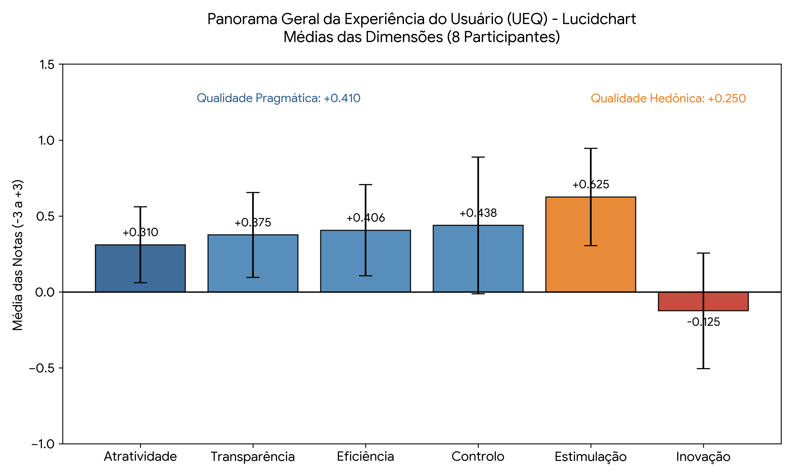
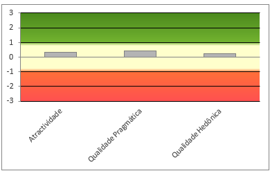
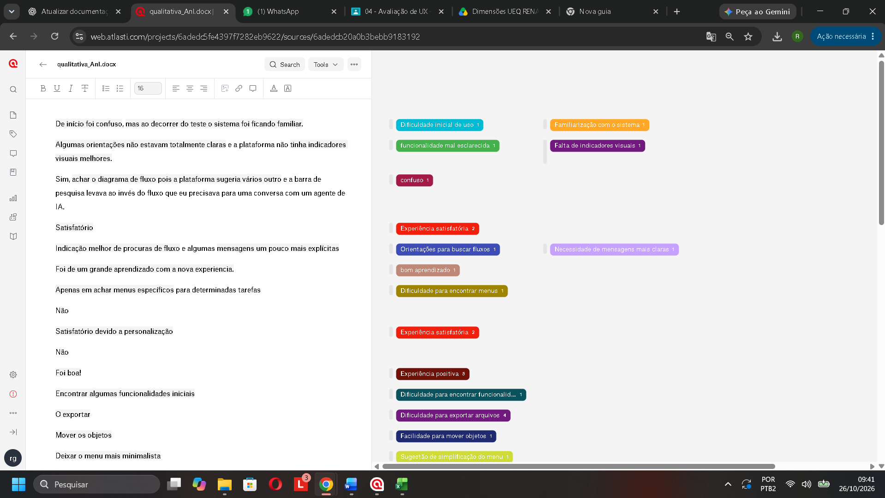
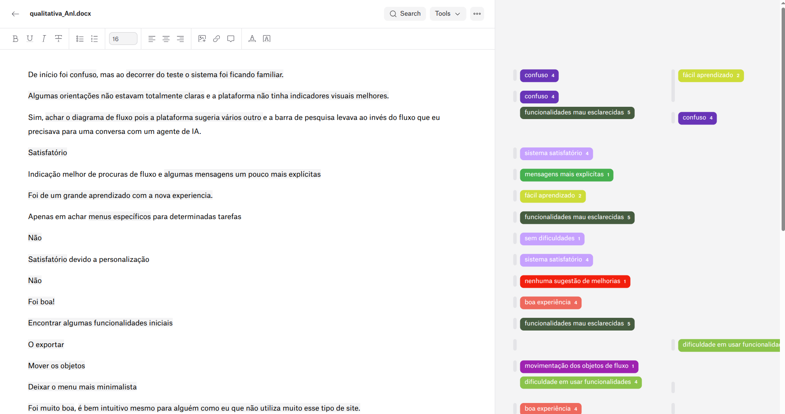
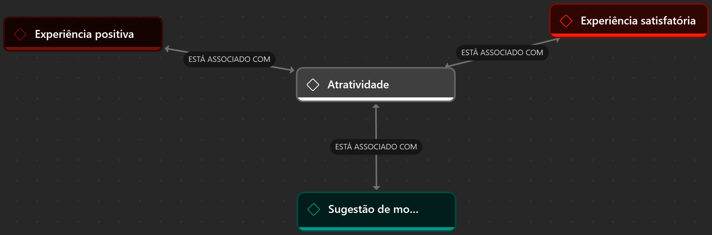
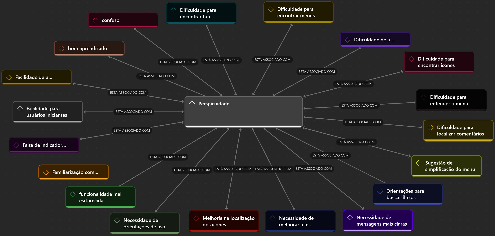
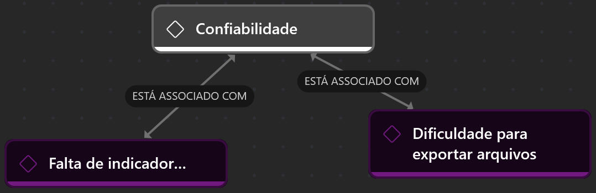
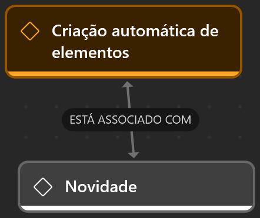

# Avaliação de Experiência do Usuário

Este repositório apresenta a avaliação da experiência do usuário (UX) da aplicação **Lucid**, realizada por meio do questionário User Experience Questionnaire (UEQ) e de uma análise qualitativa das respostas abertas dos participantes.

## 1. Aplicação do UEQ

A avaliação quantitativa foi realizada com o questionário UEQ, instrumento que analisa a experiência do usuário em seis dimensões: Atratividade, Perspicuidade, Eficiência, Confiabilidade, Estimulação e Novidade.

Ao todo, **8 participantes** responderam ao questionário. As respostas abertas do questionário pós-teste também foram analisadas no ATLAS.ti, para identificar percepções positivas, dificuldades e oportunidades de melhoria.

## 2. Resultados gerais

Os resultados gerais apresentam a percepção consolidada dos 8 participantes sobre o ecossistema do Lucidchart, mapeando o equilíbrio entre as suas dimensões detalhadas e as macro-qualidades de IHC.

<p align="center">
  
  <br>
  <em>Figura 1 — Panorama Geral da Experiência do Usuário (UEQ).</em>
</p>

### 2.1 Análise interpretativa do panorama geral

O gráfico consolida o desempenho da plataforma em três camadas analíticas complementares:

- **Qualidade Pragmática (+0,41):** mostra que o sistema atende bem aos aspectos operacionais e práticos das tarefas. Esse bloco é puxado pelo equilíbrio positivo das dimensões funcionais de **Controlo (+0,438)**, **Eficiência (+0,406)** e **Transparência (+0,375)**. Os usuários reconhecem que a interface é clara e responsiva para a construção técnica de diagramas.
- **Qualidade Hedônica (+0,25):** representa o calcanhar de Aquiles do sistema. Embora a dimensão de **Estimulação (+0,625)** indique que a proposta visual engaja e motiva o uso, a dimensão de **Inovação (-0,125)** afunda o bloco emocional na zona puramente negativa. Os usuários enxergam a ferramenta como puramente convencional, rígida e carente de diferenciais criativos (complexo de "mais do mesmo").
- **Atratividade Geral (+0,31):** o saldo global do sistema permanece positivo, porém tímido. A interface atende perfeitamente ao escopo utilitário racional do usuário, mas falha em cativar ou gerar uma experiência marcante de uso.

## 3. Análise quantitativa

### 3.1 Gráfico 1 — Médias das dimensões do UEQ

O gráfico apresenta as médias das seis dimensões do UEQ e permite comparar diferentes aspectos da experiência de uso.

<p align="center">
  
  <br>
  <em>Figura 2 — Médias obtidas em cada dimensão do UEQ.</em>
</p>

As médias calculadas foram:

| Dimensão | Média |
|---|---:|
| Atratividade | 0,31 |
| Perspicuidade | 0,38 |
| Eficiência | 0,41 |
| Confiabilidade | 0,44 |
| Estimulação | 0,63 |
| Novidade | -0,13 |

Estimulação apresentou a maior média (0,63), seguida por Confiabilidade (0,44) e Eficiência (0,41). Novidade apresentou a menor média (-0,13). Em conjunto, os valores ficam próximos da faixa neutra, sugerindo que não houve uma avaliação claramente positiva ou negativa nas dimensões consideradas.

Os resultados devem ser interpretados considerando o tamanho da amostra e complementados pela análise qualitativa das respostas abertas.

### 3.2 Gráfico 2 — Qualidade pragmática e hedônica

O gráfico compara a qualidade pragmática, relacionada à realização das tarefas, e a qualidade hedônica, relacionada à estimulação e à novidade percebidas durante o uso.

<p align="center">
  
  <br>
  <em>Figura 3 — Comparação entre qualidade pragmática e qualidade hedônica.</em>
</p>

Com base nas médias das dimensões, a qualidade pragmática apresentou média aproximada de **0,41**, enquanto a qualidade hedônica apresentou média aproximada de **0,25**. Isso indica uma percepção um pouco mais favorável dos aspectos pragmáticos do que dos hedônicos. Ambas as médias permanecem próximas da faixa neutra.

## 4. Análise qualitativa

A análise qualitativa foi realizada a partir das respostas abertas do questionário pós-teste. Os comentários foram organizados em códigos no ATLAS.ti para identificar aspectos positivos, dificuldades e oportunidades de melhoria na experiência de uso.

### 4.1 Respostas abertas dos participantes

As respostas abaixo estão identificadas apenas por números, sem nomes ou outros dados pessoais.

#### Participante 1

- **Experiência geral:** De início foi confuso, mas ao decorrer do teste o sistema foi ficando familiar.
- **Dificuldades:** Algumas orientações não estavam totalmente claras e a plataforma não tinha indicadores visuais melhores.
- **Funcionalidade difícil de encontrar:** Sim, achar o diagrama de fluxo pois a plataforma sugeria vários outro e a barra de pesquisa levava ao invés do fluxo que eu precisava para uma conversa com um agente de IA.
- **Aspecto mais fácil ou satisfatório:** Satisfatório.
- **Melhorias sugeridas:** Indicação melhor de procuras de fluxo e algumas mensagens um pouco mais explícitas.

#### Participante 2

- **Experiência geral:** Foi de um grande aprendizado com a nova experiencia.
- **Dificuldades:** Apenas em achar menus específicos para determinadas tarefas.
- **Funcionalidade difícil de encontrar:** Não.
- **Aspecto mais fácil ou satisfatório:** Satisfatório devido a personalização.
- **Melhorias sugeridas:** Não.

#### Participante 3

- **Experiência geral:** Foi boa!
- **Dificuldades:** Encontrar algumas funcionalidades iniciais.
- **Funcionalidade difícil de encontrar:** O exportar.
- **Aspecto mais fácil ou satisfatório:** Mover os objetos.
- **Melhorias sugeridas:** Deixar o menu mais minimalista.

#### Participante 4

- **Experiência geral:** Foi muito boa, é bem intuitivo mesmo para alguém como eu que não utiliza muito esse tipo de site.
- **Dificuldades:** No começo do teste eu acabei criando setas sem querer e tive dificuldade para excluí-las depois.
- **Funcionalidade difícil de encontrar:** Sim, apenas quando eu tinha que deixar um comentário e fiquei procurando no mesmo lugar que ficava as reações.
- **Aspecto mais fácil ou satisfatório:** Gostei que dá para por textos diretamente nas caixas, pode parecer algo simples mas eu realmente gosto de não ter que me preocupar com o alinhamento de cada frase. E apesar de eu ter tido dificuldade, a criação automática de setas e quadros é muito útil.
- **Melhorias sugeridas:** Achei bem completo no geral, se não tiver seria bom um modo escuro.

#### Participante 5

- **Experiência geral:** boa.
- **Dificuldades:** menu pouco intuitivo.
- **Funcionalidade difícil de encontrar:** renomear o arquivo.
- **Aspecto mais fácil ou satisfatório:** alterar o texto.
- **Melhorias sugeridas:** melhorar o sistema de navegaçao.

#### Participante 6

- **Experiência geral:** Tranquilo.
- **Dificuldades:** Achar alguns ícones.
- **Funcionalidade difícil de encontrar:** Como colocar cor nos negócios la.
- **Aspecto mais fácil ou satisfatório:** A visualização do fluxograma.
- **Melhorias sugeridas:** Ícones.

#### Participante 7

- **Experiência geral:** Foi boa.
- **Dificuldades:** Mudar o nome do fluxograma, exportar.
- **Funcionalidade difícil de encontrar:** A exportação.
- **Aspecto mais fácil ou satisfatório:** Usar os blocos.
- **Melhorias sugeridas:** A exportação, dicas pra usar o site.

#### Participante 8

- **Experiência geral:** achei meio monótono, já vi sites melhores.
- **Dificuldades:** não achei muito intuitivo.
- **Funcionalidade difícil de encontrar:** não muita.
- **Aspecto mais fácil ou satisfatório:** acho que a visualização de fluxogramas.
- **Melhorias sugeridas:** ser mais intuitivo e resolver a tela de login.

### 4.2 Processo de codificação no ATLAS.ti

As respostas foram importadas e analisadas no ATLAS.ti. A partir da leitura dos comentários, foram criados códigos que representam temas recorrentes, percepções positivas, dificuldades e sugestões. Em seguida, os códigos foram relacionados às dimensões do UEQ nas redes correspondentes.

<p align="center">
  
  <br>
  <em>Figura 4 — Organização das citações e dos códigos no ATLAS.ti.</em>
</p>

### 4.3 Códigos identificados

A análise resultou em **36 códigos**, utilizados para representar diferentes aspectos relatados pelos participantes.

<p align="center">
  
  <br>
  <em>Figura 5 — Lista de códigos utilizados na análise qualitativa.</em>
</p>

| Nº | Código |
|---:|---|
| 1 | Experiência positiva |
| 2 | Experiência satisfatória |
| 3 | Sugestão de modo escuro |
| 4 | Sugestão de simplificação do menu |
| 5 | Confuso |
| 6 | Dificuldade inicial de uso |
| 7 | Dificuldade de uso intuitivo |
| 8 | Facilidade de uso intuitivo |
| 9 | Familiarização com o sistema |
| 10 | Bom aprendizado |
| 11 | Facilidade para usuários iniciantes |
| 12 | Dificuldade para encontrar funcionalidades |
| 13 | Dificuldade para encontrar ícones |
| 14 | Dificuldade para encontrar menus |
| 15 | Dificuldade para entender o menu |
| 16 | Funcionalidade mal esclarecida |
| 17 | Falta de indicadores visuais |
| 18 | Necessidade de mensagens mais claras |
| 19 | Necessidade de orientações de uso |
| 20 | Orientações para buscar fluxos |
| 21 | Necessidade de melhorar a intuitividade |
| 22 | Dificuldade para localizar comentários |
| 23 | Melhoria na localização dos ícones |
| 24 | Dificuldade para alterar cores |
| 25 | Dificuldade para excluir setas |
| 26 | Dificuldade para exportar arquivos |
| 27 | Dificuldade para renomear arquivos |
| 28 | Facilidade para editar textos |
| 29 | Facilidade para inserir textos |
| 30 | Facilidade para mover objetos |
| 31 | Facilidade para utilizar blocos |
| 32 | Alinhamento automático de texto |
| 33 | Criação automática de elementos |
| 34 | Necessidade de melhorar a navegação |
| 35 | Experiência pouco estimulante |
| 36 | Problema na tela de login |

Os códigos representam aspectos positivos e dificuldades relatadas. A interpretação deve considerar o contexto das citações originais, pois um comentário isolado não representa necessariamente toda a experiência de uso.

### 4.4 Redes construídas no ATLAS.ti

Foram construídas seis redes, uma para cada dimensão do UEQ. Elas mostram as associações estabelecidas entre as dimensões e os códigos pertinentes identificados nas respostas.

#### 4.4.1 Atratividade

<p align="center">
  
  <br>
  <em>Figura 6 — Rede de códigos relacionada à dimensão Atratividade.</em>
</p>

A Atratividade está relacionada à impressão geral que o usuário tem da aplicação. Os códigos **Experiência positiva** e **Experiência satisfatória** ajudam a interpretar avaliações gerais favoráveis quando esse sentido estiver presente nas citações.

#### 4.4.2 Perspicuidade

<p align="center">
  
  <br>
  <em>Figura 7 — Rede de códigos relacionada à dimensão Perspicuidade.</em>
</p>

A Perspicuidade está relacionada à facilidade de compreender a aplicação e aprender a utilizá-la. Códigos como **Confuso**, **Dificuldade inicial de uso**, **Familiarização com o sistema**, **Bom aprendizado**, **Facilidade para usuários iniciantes** e **Necessidade de melhorar a intuitividade** ajudam a interpretar essa dimensão. Também são relevantes as dificuldades para encontrar funcionalidades, ícones e menus.

#### 4.4.3 Eficiência

<p align="center">
  
  <br>
  <em>Figura 8 — Rede de códigos relacionada à dimensão Eficiência.</em>
</p>

A Eficiência está relacionada à facilidade e à fluidez na realização das tarefas. Códigos como **Dificuldade para localizar comentários**, **Dificuldade para exportar arquivos**, **Dificuldade para renomear arquivos**, **Dificuldade para alterar cores** e **Dificuldade para excluir setas** representam obstáculos. Códigos como **Facilidade para editar textos**, **Facilidade para inserir textos**, **Facilidade para mover objetos**, **Facilidade para utilizar blocos** e **Alinhamento automático de texto** representam aspectos que podem favorecer as tarefas.

#### 4.4.4 Confiabilidade

<p align="center">
  
  <br>
  <em>Figura 9 — Rede de códigos relacionada à dimensão Confiabilidade.</em>
</p>

A Confiabilidade está relacionada à previsibilidade e ao controle percebidos durante o uso. Códigos como **Falta de indicadores visuais**, **Necessidade de mensagens mais claras**, **Necessidade de orientações de uso** e **Problema na tela de login** contribuem para a análise quando as citações indicam dúvidas sobre o estado do sistema ou dificuldades para realizar ações com segurança.

#### 4.4.5 Estimulação

<p align="center">
  
  <br>
  <em>Figura 10 — Rede de códigos relacionada à dimensão Estimulação.</em>
</p>

A Estimulação está relacionada ao interesse e à motivação proporcionados pela aplicação. Os códigos **Experiência positiva**, **Experiência satisfatória** e **Experiência pouco estimulante** ajudam a interpretar como os participantes perceberam o interesse despertado pelo sistema. Sugestões de personalização, como o modo escuro, devem ser consideradas conforme o contexto das respostas.

#### 4.4.6 Novidade

<p align="center">
  
  <br>
  <em>Figura 11 — Rede de códigos relacionada à dimensão Novidade.</em>
</p>

A Novidade está relacionada à percepção de inovação e originalidade. O código **Criação automática de elementos** pode contribuir para essa análise quando a citação expressar uma percepção de inovação. Sugestões de melhoria, como a simplificação do menu e o modo escuro, não representam necessariamente uma avaliação de originalidade; a interpretação depende do contexto das respostas.

## 5. Considerações sobre a experiência do usuário

A avaliação quantitativa apresentou a maior média em Estimulação (0,63), enquanto Novidade obteve a menor (-0,13). As demais dimensões tiveram médias entre 0,31 e 0,44. A análise qualitativa complementa esses resultados ao identificar percepções positivas, dificuldades de aprendizagem, obstáculos de navegação e sugestões de melhoria.

As redes do ATLAS.ti permitem relacionar os comentários às seis dimensões do UEQ e ajudam a interpretar os resultados quantitativos. Em conjunto, os dados apontam oportunidades para melhorar a clareza das funcionalidades, a organização dos menus, a localização de recursos e a interação com os diagramas. As conclusões se limitam às respostas analisadas e não devem ser generalizadas para todos os usuários da aplicação.

## 6. Organização das imagens

As imagens utilizadas nesta documentação devem estar na pasta `imagens/`, localizada na raiz do repositório, com os nomes correspondentes aos caminhos utilizados no README.

```text
.
├── README.md
└── imagens/
    ├── Atratividade.png
    ├── Confiabilidade.png
    ├── Eficiência.png
    ├── Estimulação.png
    ├── Novidade.png
    ├── Perspicuidade.png
    ├── grafico2.png
    ├── grafico3.png
    ├── qualitativa.png
    ├── qualitativa1.png
    └── ueq_panorama_geral_lucidchart.png
```
