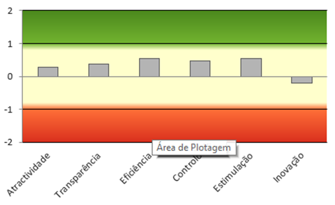
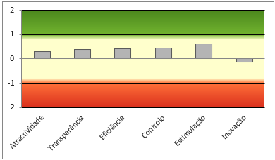

# Avaliação de Experiência do Usuário

Este repositório apresenta a avaliação da experiência do usuário (UX) da aplicação **Lucid**, realizada por meio do questionário User Experience Questionnaire (UEQ) e de uma análise qualitativa das respostas abertas dos participantes.

## 1. Aplicação do UEQ

A avaliação quantitativa foi realizada utilizando o questionário UEQ, instrumento que permite analisar a experiência do usuário a partir de seis dimensões: Atratividade, Perspicuidade, Eficiência, Confiabilidade, Estimulação e Novidade.

Ao todo, **6 participantes** responderam ao questionário.

## 2. Resultados gerais

Os resultados obtidos permitem observar a percepção dos participantes em relação à experiência de uso da aplicação.


*Figura 1 — Resultados gerais da avaliação UEQ.*

## 3. Análise quantitativa

### 3.1 Gráfico 1 — Médias das dimensões do UEQ



*Figura 2 — Médias obtidas em cada dimensão do UEQ.*

As médias obtidas foram:

| Dimensão | Média |
|---|---:|
| Atratividade | 0,28 |
| Perspicuidade | 0,38 |
| Eficiência | 0,54 |
| Confiabilidade/Controle | 0,46 |
| Estimulação | 0,54 |
| Novidade | -0,21 |

Os resultados indicam que Eficiência e Estimulação apresentaram as maiores médias, ambas com 0,54. A dimensão Novidade apresentou a menor média, com -0,21, indicando uma percepção menos positiva dos participantes em relação a esse aspecto da experiência.

### 3.2 Gráfico 2 — Qualidade pragmática e hedônica



*Figura 3 — Comparação entre qualidade pragmática e qualidade hedônica.*

A qualidade pragmática apresentou média de **0,46**, enquanto a qualidade hedônica apresentou média de **0,17**.

Esses resultados sugerem uma percepção relativamente mais favorável dos aspectos relacionados à realização das tarefas do que dos aspectos ligados à estimulação e à experiência subjetiva de uso.

## 4. Análise qualitativa

A análise qualitativa foi organizada a partir das respostas abertas dos participantes. Os comentários foram agrupados em códigos para identificar aspectos positivos, dificuldades e oportunidades de melhoria na experiência de uso.

### 4.1 Respostas abertas dos participantes

As respostas abertas devem ser inseridas abaixo, preservando o conteúdo original de cada participante.

- **Participante 1:** [Inserir resposta original]
- **Participante 2:** [Inserir resposta original]
- **Participante 3:** [Inserir resposta original]
- **Participante 4:** [Inserir resposta original]
- **Participante 5:** [Inserir resposta original]
- **Participante 6:** [Inserir resposta original]

> **Observação:** substitua os campos acima pelas respostas reais coletadas durante a avaliação.

### 4.2 Processo de codificação no ATLAS.ti

As respostas foram analisadas com o auxílio do ATLAS.ti, ferramenta utilizada para organizar dados qualitativos, identificar temas recorrentes e relacionar os comentários às dimensões da experiência do usuário.


*Figura 4 — Exemplo da organização de citações e códigos no ATLAS.ti.*

### 4.3 Códigos identificados


*Figura 5 — Lista de códigos utilizados na análise qualitativa.*

Os códigos identificados foram:

- Boa experiência
- Sistema satisfatório
- Confuso
- Fácil aprendizado
- Funcionalidade pouco intuitiva
- Funcionalidades mal esclarecidas
- Localizar ícones
- Melhorar localização de ícones
- Melhorar sistema de navegação
- Mensagens mais explícitas
- Sem dificuldades
- Sistema fácil de usar
- Sistema intuitivo
- Dificuldade em usar funcionalidades
- Movimentação dos objetos de fluxo
- Problema com diagrama de fluxo

Os códigos representam percepções positivas e dificuldades relatadas pelos participantes. Sua interpretação deve considerar o contexto de cada comentário original.

### 4.4 Redes construídas no ATLAS.ti

As redes semânticas ajudam a visualizar as relações entre os códigos identificados e as dimensões do UEQ. As associações devem ser interpretadas considerando o significado dos comentários dos participantes.

#### 4.4.1 Atratividade


*Figura 6 — Rede de códigos relacionada à dimensão Atratividade.*

Os códigos **Boa experiência** e **Sistema satisfatório** podem contribuir para a análise da atratividade quando os comentários expressarem uma avaliação positiva da aplicação.

#### 4.4.2 Perspicuidade


*Figura 7 — Rede de códigos relacionada à dimensão Perspicuidade.*

Esta dimensão está relacionada à facilidade de compreender e aprender a utilizar a aplicação. Códigos como **Confuso**, **Fácil aprendizado**, **Funcionalidade pouco intuitiva**, **Funcionalidades mal esclarecidas**, **Localizar ícones** e **Sistema intuitivo** podem ajudar a interpretar essa dimensão.

#### 4.4.3 Eficiência


*Figura 8 — Rede de códigos relacionada à dimensão Eficiência.*

A análise da eficiência considera a facilidade e a fluidez na realização das tarefas. Códigos como **Dificuldade em usar funcionalidades**, **Melhorar localização de ícones**, **Melhorar sistema de navegação**, **Movimentação dos objetos de fluxo** e **Problema com diagrama de fluxo** podem indicar obstáculos durante a utilização.

#### 4.4.4 Confiabilidade/Controle


*Figura 9 — Rede de códigos relacionada à dimensão Confiabilidade/Controle.*

Esta dimensão pode ser analisada a partir de comentários sobre previsibilidade, clareza e controle durante o uso. Códigos como **Confuso**, **Mensagens mais explícitas** e **Problema com diagrama de fluxo** devem ser associados a essa dimensão somente quando o contexto das respostas indicar essas questões.

#### 4.4.5 Estimulação


*Figura 10 — Rede de códigos relacionada à dimensão Estimulação.*

A dimensão Estimulação está relacionada ao interesse e à motivação proporcionados pela aplicação. Códigos como **Boa experiência**, **Sistema satisfatório** e **Sistema intuitivo** podem ser relacionados a ela quando os comentários expressarem interesse, satisfação ou vontade de continuar utilizando o sistema.

#### 4.4.6 Novidade


*Figura 11 — Rede de códigos relacionada à dimensão Novidade.*

A dimensão Novidade está relacionada à percepção de inovação e originalidade. Os códigos ligados a melhorias podem contribuir para essa análise quando os comentários indicarem explicitamente questões de inovação, modernidade ou diferenciação. Dificuldades de navegação e de compreensão, isoladamente, não significam necessariamente baixa novidade.

## 5. Considerações sobre a experiência do usuário

A avaliação quantitativa apontou resultados positivos moderados em Eficiência e Estimulação, enquanto Novidade apresentou a menor média. A análise qualitativa complementa esses resultados ao reunir percepções sobre facilidade de aprendizado, localização de ícones, navegação e utilização das funcionalidades.

Em conjunto, os resultados sugerem oportunidades para melhorar a clareza das funcionalidades, a organização da navegação e a interação com os diagramas de fluxo. Essas oportunidades devem ser priorizadas de acordo com a frequência e o contexto das respostas reais dos participantes.

## 6. Organização das imagens

Para que as imagens apareçam corretamente no GitHub, organize os arquivos nas seguintes pastas:

```text
.
├── README.md
└── imagens/
    ├── ueq-resultados.png
    ├── grafico-01.png
    ├── grafico-02.png
    ├── atlas-citacoes-codigos.png
    ├── atlas-lista-codigos.png
    ├── rede-atratividade.png
    ├── rede-perspicuidade.png
    ├── rede-eficiencia.png
    ├── rede-confiabilidade.png
    ├── rede-estimulacao.png
    └── rede-novidade.png
```

**Importante:** os nomes acima são referências para as imagens. Substitua os arquivos de exemplo pelas capturas reais e mantenha os nomes iguais aos utilizados neste README, ou atualize os caminhos no código.
